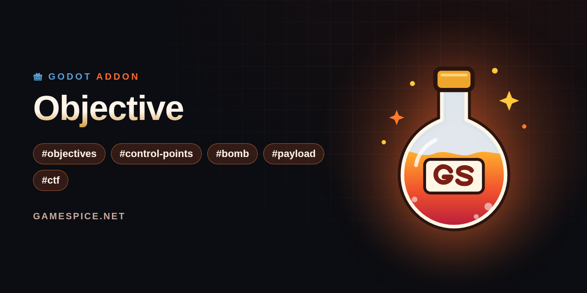

[](https://moddingcommunity.com/a/240-dot-objective)

The part of a multiplayer game that says what a round is about: control points, a bomb to plant and defuse, a payload to push, a flag to capture, someone to escort out, and a clock to hold. It needs only [dot-core](https://github.com/gamespice-platform/core). Part of TMC's open source [**GameSpice**](https://gamespice.net) collection (MIT licence).

> Built with Claude Code. Every addon has a headless test suite and the suites pass, but little of this has met real players yet. Please report rough edges.

## What it does

An objective is what a team is trying to do in a round other than kill the other team. There are six kinds:

| Kind | What it is |
| --- | --- |
| `CAPTURE` | A control point. Stand on it long enough and your team owns it. |
| `BOMB` | Plant a bomb at a site. The other team defuses it before the fuse runs out. |
| `PAYLOAD` | A cart that moves along a path while the attacking team stands next to it. |
| `FLAG` | Take the other team's flag back to your own base. |
| `RESCUE` | Lead someone (or several people) to an exit. |
| `HOLDOUT` | Hold a point, or just survive, until a clock runs out. |

The manager runs every objective on the map each tick: who stands where, how far a capture or cart has got, whether a defuse was interrupted. It tells your game when something started, was interrupted, was blocked or finished. It never ends a round itself; [dot-match](https://github.com/gamespice-platform/match) does that. A game with no objectives is a deathmatch, which dot-match handles on its own.

The default numbers follow what objective modes have settled on over the years:

- More players capture faster, but each adds less. At the default 480 ticks, one player takes 480 ticks, two take 320, three take 263.
- Both teams on a point pauses it. A defender only gets credit for blocking if the capture was at least half done.
- A capture left alone drains over 90 seconds and does not snap back, six times faster in overtime.
- A cart moves at 0.55, 0.77 and 1.0 of full speed with one, two, and three or more pushers. A downhill part of the path rolls it with nobody pushing.

Tick counts here assume 64 ticks per second.

## Install

Copy `addons/dot_objective/` and dot-core's `addons/dot_core/` into your project and enable dot-objective under **Project > Project Settings > Plugins**. [dot-bootstrap](https://github.com/gamespice-platform/bootstrap) can set up a whole project for you. Needs Godot 4.7 or newer.

## Use

```gdscript
var objectives := DotObjectiveManager.new()
objectives.presence = DotObjectivePresence.of(
    roster.keys,          # () -> PackedStringArray
    world.position_of,    # (key) -> Vector3
    match_node.team_of,   # (key) -> int, teams start at 1
    world.is_alive        # (key) -> bool
)
objectives.score_fn = func(id, team, by, points, player_points):
    match_node.report_objective(by, id, tick, points)

var res := objectives.setup(map.objectives)   # an Array[DotObjectiveDef]
if not res.ok:
    push_error(res.error.message)
add_child(objectives)

objectives.set_live(true)    # when warmup or freeze time ends
objectives.advance(tick)     # once per tick
objectives.reset_round()     # between rounds
```

Nothing makes progress until `set_live(true)`, because during warmup everybody stands on everything. Turn it off again for freeze time and at the end of a round.

Each kind has a factory on `DotObjectiveDef`:

```gdscript
DotObjectiveDef.capture(&"mid", DotObjectiveArea.cylinder(Vector3.ZERO, 4.0))
DotObjectiveDef.bomb(&"site_a", DotObjectiveArea.box(site_centre, Vector3(4, 2, 4)))
DotObjectiveDef.payload(&"cart", path_points)   # then set capturable_by to the pushing team
DotObjectiveDef.flag(&"red_flag", DotObjectiveArea.sphere(red_base, 2.0), 1)
DotObjectiveDef.rescue(&"hostages", start_points, DotObjectiveArea.sphere(exit, 3.0))
DotObjectiveDef.holdout(&"radio", 10800)
```

Set `capturable_by` to limit which teams may act on an objective (a bomb site only one side plants at), `initial_team` for who owns it at the start, and `requires_owned` to lock a point until a team owns the one before it. A payload needs a pushing team, from `capturable_by` or `initial_team`, or nobody can push it.

Captures, carts and holdouts run from where players stand. The other kinds need your game to say what a player did, because only it knows about items and buttons:

| Kind | Calls |
| --- | --- |
| Bomb | `give_to(key)`, `drop_at(position)` when the carrier dies, `try_pick_up(key, presence)`, `begin_plant(key, presence)`, `begin_defuse(...)`. A plant or defuse cancels itself if the player dies, leaves the site or moves away. |
| Flag | `touch(key, presence)` to pick up or return, `drop(position)`. A carrier reaching their own base scores. |
| Rescue | `take(id, key, presence)`, `release(id)`, `lose(id)`. |

Get a kind's object with `objectives.objective(&"site_a")`.

| Signal | When |
| --- | --- |
| `objective_started` | An objective begins making progress. |
| `objective_progressed` | Progress changed. |
| `objective_interrupted` | A capture, plant or defuse was cut short. |
| `objective_blocked` | The other team stopped it. |
| `objective_completed` | It finished. |
| `objective_event` | Anything else a kind wants to say. |
| `all_captured` | One team owns every capture point. |
| `round_objective_met` | An objective marked `wins_round` completed. Your game ends the round. |

A client mirrors the server's state instead of running it:

```gdscript
mirror.authoritative = false
mirror.setup(map.objectives)
mirror.apply_wire(wire_from_the_server)   # the server sends objectives.to_wire()
```

## Settings

Round-wide rules live in a `DotObjectiveRules` resource set on the manager's `rules` (a default is made if you leave it empty). It is layered like every GameSpice config: defaults, JSON file, `DOT_OBJECTIVE_*` environment, `--objective-*` command line. Call `load_layered()` before `setup()`:

```gdscript
var rules := DotObjectiveRules.new()
rules.load_layered("user://objectives.json")
objectives.rules = rules
```

```bash
GS_OBJECTIVE_BLOCK_STYLE=0 godot --headless -- --objective-deteriorate-ticks=3840
```

| Setting | Default | What it does |
| --- | --- | --- |
| `block_style` | 1 | Both teams on a point: 0 resets the capture, 1 pauses it. |
| `deteriorate_ticks` | 5760 | How long an abandoned capture takes to drain (90 seconds). |
| `overtime_decay_multiplier` | 6.0 | How much faster it drains in overtime. |
| `block_credit_fraction` | 0.5 | How far along a capture must be for a blocker to get credit. |
| `capture_recovery_ticks` | 0 | Wait after a broken capture before it can start again. |
| `payload_speed_one`, `payload_speed_two`, `payload_speed_three` | 0.55, 0.77, 1.0 | Cart speed with one, two, and three or more pushers. |
| `payload_recede_speed` | 0.1 | How fast an idle cart rolls back. |
| `payload_recede_overtime_ticks` | 320 | Idle time in overtime before the cart rolls back (5 seconds). |
| `payload_defenders_block` | true | A defender next to the cart stops it. |
| `live` | false | Whether anything makes progress. Use `set_live()`. |
| `overtime` | false | Overtime is on. Use `set_overtime()`. |
| `announce_only` | true | Completing a `wins_round` objective emits `round_objective_met` and does nothing else. This addon never ends a round, so there is no other value. |

### Per objective (`DotObjectiveDef`)

Each objective carries its own timings as fields. Ticks are at 64 per second.

| Field | Default | What it does |
| --- | --- | --- |
| `score_points`, `player_points` | 1, 0 | Team and personal points for completing it. |
| `wins_round` | false | Completing it fires `round_objective_met`. |
| `capture_ticks` | 480 | Time for one player to capture. |
| `capture_required_to_start`, `capture_required` | 1, 1 | Players needed to start, and to count at full speed. |
| `capture_scales_with_players` | true | More players capture faster. |
| `bomb_plant_ticks` | 192 | Plant time. |
| `bomb_fuse_ticks` | 2880 | Time from plant to explosion. |
| `bomb_defuse_ticks`, `bomb_defuse_kit_ticks` | 640, 320 | Defuse time without and with a kit. |
| `bomb_defuse_radius`, `bomb_pickup_radius` | 2.0, 1.5 | Metres. |
| `payload_speed` | 0.03 | Cart progress per tick at full speed. |
| `payload_push_radius` | 3.0 | Metres from the cart to count as pushing. |
| `payload_recede_ticks` | 1920 | Idle time before the cart rolls back. |
| `flag_return_ticks` | 960 | Time a dropped flag lies before it returns. |
| `flag_touch_returns` | true | A teammate touching a dropped flag returns it. |
| `flag_requires_own_at_home` | false | Capturing needs your own flag at home. |
| `flag_touch_radius` | 1.5 | Metres. |
| `flag_pickup_delay_ticks` | 0 | Delay after a drop before anyone can pick it up. |
| `rescue_touch_radius`, `rescue_follow_distance` | 2.0, 2.0 | Metres. |
| `rescue_required` | 0 | How many must reach the exit. 0 = all. |
| `holdout_ticks` | 10800 | How long to hold (3 minutes). |
| `holdout_requires_presence` | false | Someone must stand on the point for the clock to run. |
| `holdout_all_teams` | false | The clock runs for every team. |

## More

[docs/design.md](docs/design.md) explains the choices and [docs/history.md](docs/history.md) lists bugs worth recognising if they return.

## Testing

```bash
godot --headless --path . --import
godot --headless --path . res://examples/objective_selftest.tscn
```

## Licence

MIT. See [LICENSE](LICENSE).
